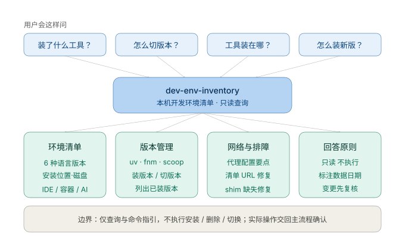

# windows-toolkit

> Windows 开发环境「环境即代码」工具箱 —— 一份可复现、可迁移、可版本控制的开发机配置方案。

把一台 Windows 11 开发机从裸机配置到「六语言命令行版本管理 + 容器 + 本地大模型」的全过程，沉淀为文档、脚本与 Skill。换机器时不用凭记忆重装，克隆本仓库跑一遍 bootstrap 即可还原环境。

---

## 为什么有这个项目

一台开发机用久了会积累三类问题：

1. **环境漂移** —— 工具装在哪、什么版本、怎么配置的，全靠记忆，重装时一团乱麻。
2. **资源浪费** —— 磁盘空间告急、内存和 CPU 闲置、本地大模型和容器没协同好。
3. **重复劳动** —— 每次换机器或重装都要重新踩一遍网络代理、下载源失效的坑。

本项目把这三件事固化下来：**环境有清单、配置有脚本、经验有文档**。

---

## 配套 Skill 能力一览

仓库内置的 `dev-env-inventory` Skill 把「这台机器怎么配的」变成随时可查的知识。您用自然语言提问，它依据本仓库的权威清单精确回答，**全程只读、不改动环境**：



四大能力域：

| 能力域 | 能回答什么 |
|---|---|
| **环境清单** | 装了哪些工具、什么版本、装在哪个盘、磁盘如何分布 |
| **版本管理** | 六语言（Python/Node/PHP/Java/Go/Ruby）怎么装新版本、切换版本、列出已装版本 |
| **网络与排障** | scoop 代理为何这样配、下载链接失效/ shim 缺失怎么修 |
| **回答原则** | 只读查询不执行、标注数据日期、环境可疑时先只读复核 |

典型问法：「我这台电脑装了哪些开发工具」「怎么切 Node 版本」「Go 装在哪、什么版本」。
Skill 源文件：[`skill/dev-env-inventory/SKILL.md`](skill/dev-env-inventory/SKILL.md) · 详细清单：[`docs/01-environment-inventory.md`](docs/01-environment-inventory.md)

---

## 目标环境画像

方案针对这样一台机器（本文作者的实际配置，可作为参考基准）：

| 维度 | 配置 |
|---|---|
| CPU | Intel i5-12500（6 核 12 线程） |
| 内存 | 24 GB |
| GPU | AMD RX 560 4GB + Intel UHD 770 核显 |
| 磁盘 | C 326GB / D 203GB / E 202GB / H 200GB（合计约 900GB） |
| 系统 | Windows 11 |

硬件定位：** CPU 多线程强、内存充裕、独显较弱、多盘位宽裕**。因此方案的核心策略是——计算靠 CPU/内存（本地 AI 走 CPU 推理），存储靠多盘分流（系统与数据分离），不依赖独显算力。

---

## 目录结构

```
windows-toolkit/
├── README.md                          # 本文件：项目说明 + 资源利用总纲
├── docs/
│   ├── assets/
│   │   └── skill-capabilities.svg     # Skill 能力图（README 内嵌）
│   ├── 01-environment-inventory.md    # 完整开发环境清单
│   ├── 02-version-management.md       # 六语言版本管理速查
│   ├── 03-resource-guide.md           # 硬件资源利用指南（核心）
│   └── 04-network-and-scoop.md        # 网络受限下的 scoop 配置经验
├── scripts/
│   ├── bootstrap.ps1                  # 一键初始化（可复现环境的核心）
│   ├── install/
│   │   ├── setup-scoop.ps1            # scoop 手动部署（绕开失效安装脚本）
│   │   ├── setup-fnm.ps1              # fnm + Node LTS
│   │   ├── setup-uv.ps1               # uv + Python
│   │   └── setup-buckets.ps1          # 添加软件源并修复下载链接
│   └── maintenance/
│       ├── env-check.ps1              # 环境健康检查（只读）
│       └── disk-usage.ps1             # 磁盘占用扫描（只读）
├── skill/
│   └── dev-env-inventory/             # 配套 WorkBuddy Skill
│       └── SKILL.md
└── .gitignore
```

---

## 快速开始

### 新机器初始化

```powershell
# 1. 克隆仓库
git clone git@github.com:<你的账号>/windows-toolkit.git
cd windows-toolkit

# 2. 以普通用户身份运行 bootstrap（无需管理员，脚本会自动判断）
powershell -ExecutionPolicy Bypass -File .\scripts\bootstrap.ps1

# 3. 重开终端，验证环境
powershell -ExecutionPolicy Bypass -File .\scripts\maintenance\env-check.ps1
```

### 日常使用

- **查环境**：问 WorkBuddy「我这装了什么开发工具」，Skill 会依据 `docs/01-environment-inventory.md` 精确回答。
- **切版本**：查 `docs/02-version-management.md`，一句话命令切换六语言的任意已装版本。
- **体检**：定期跑 `env-check.ps1` 和 `disk-usage.ps1`，只读、不改任何东西。

---

## 如何用好这台机器（资源利用总纲）

详细的、可操作的方案见 [`docs/03-resource-guide.md`](docs/03-resource-guide.md)。这里给出核心思路：

### 1. 存储分层：让每块盘各司其职

```
C: 系统 + 工具程序        （速度快，只放系统和 scoop/uv/fnm 管理的程序）
D: 应用数据 + 虚拟内存    （pagefile 放这里，给 C 盘减负）
E: 代码仓库 + Docker 数据 （频繁读写，独立盘避免和系统抢 IO）
H: 大模型 + 冷数据        （容量大，存放 Ollama/LM Studio 模型）
```

**关键动作**：把 16GB 的本地大模型和 15GB 的 Docker 数据从 C 盘迁到 H/E 盘，C 盘立刻释放 30GB+。虚拟内存迁到 D 盘再释放十余 GB。这是这台机器最直接的空间优化。

### 2. 计算协同：CPU 多线程 + 大内存跑本地 AI

RX 560 只有 4GB 显存，跑不动现代大模型；但 24GB 内存 + 12 线程 CPU 完全可以在内存里流畅推理 7B/14B 量化模型。策略：

- Ollama 设置 `OLLAMA_HOST` 和并发数，让模型走 CPU + 内存（ quantized q4/q5 模型）。
- 同时运行 Docker 时，给容器限内存（如 12GB），留一半给本地模型，避免互相挤爆。
- 编译/构建任务用满 12 线程（`make -j12`、`MSBuild /m:12`、pnpm 并行），缩短等待。

### 3. 环境一致性：所有语言走命令行版本管理

Python→uv、Node→fnm、PHP/Java/Go/Ruby→scoop。好处：

- 版本可复现：项目要什么版本，一条命令切换，不污染全局。
- 升级可逆：`scoop reset`/`fnm use` 秒级回退。
- 新机器可复现：bootstrap 脚本自动装齐。

### 4. 用 Skill 把经验变成随时可查的知识

`skill/dev-env-inventory` 让「这台机器怎么配的」不再依赖记忆。您用自然语言问，AI 直接依据仓库里的权威清单回答；环境变化时用只读脚本复核并更新清单，形成闭环。

---

## 设计原则

- **只读优先**：`maintenance/` 下所有脚本只扫描、不改动，扫描结果供人决策。
- **幂等可重复**：`install/` 下脚本可反复运行，不会破坏已有环境。
- **参数化无隐私**：所有脚本用 `$env:USERPROFILE` 等变量，不写死用户名和路径。
- **网络降级**：考虑国内网络受限，提供 gh-proxy 等替代通道的处理经验。

---

## 适用与不适用

**适用**：Windows 11 个人开发机、需要多语言版本共存、关注磁盘空间与本地 AI、希望环境可复现。

**不适用**：企业域管环境（策略限制脚本执行）、需要严格合规审计的生产服务器、macOS/Linux（路径与工具链不同）。

---

## 许可证

MIT —— 自由使用、修改、分享。
